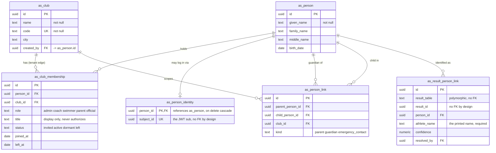
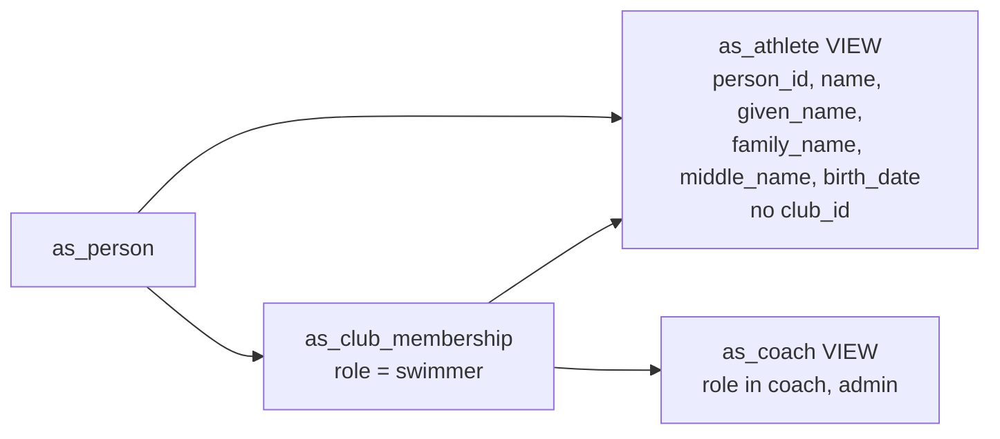
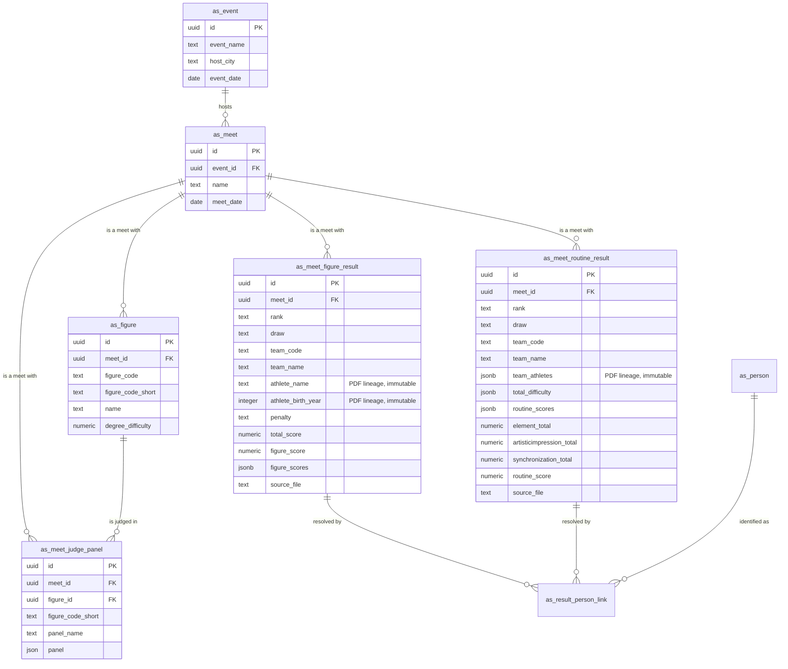
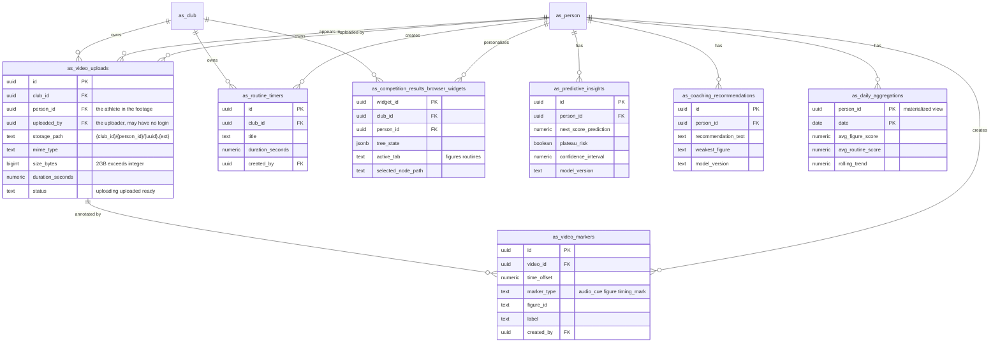

# Data Model: Artistic Swimming Analytics Dashboard

> **Diagrams.** The three ER diagrams below are the authoritative picture of the
> schema: (1) identity and tenancy, (2) competition ingestion and identity
> resolution, (3) dashboard entities.
>
> They describe the schema created by
> `backend/supabase/migrations/20260827_all_schema_from_scratch.sql` — a single
> script applied to an empty database, which is the contract for a fresh install.
> It consolidates four earlier migrations (`20260804`, both `20260819` files and
> `20260820`), now removed; the legacy `as_competition_result` table and the
> `updated_at` columns/triggers on `as_video_uploads` / `as_routine_timers` are
> declared there because the later re-declarations of those tables had silently
> dropped them. `20260826_person_identity_migration.sql` remains in the directory
> but is a *data* transform for databases holding legacy `as_athlete` / `as_coach`
> rows, not part of the schema. If a diagram and the field lists below disagree,
> the SQL wins — the field lists are prose, the migrations are the contract.

## Entity Relationship Diagrams

### 1. Identity and tenancy

The load-bearing part of the model. A person is a human, a club is the tenant, and
membership is the edge between them.

Three properties the diagram is meant to make obvious, because each one was
previously wrong:

- **`as_club_membership` is the authorization source of truth.** It is the only
  path from a person to a club, so a role is always evaluated as
  (person, club, role). There is no `club_id` on `as_person` to drift out of sync.
- **`as_person_identity` is optional and 1:1.** A person with no row here is a
  full member of the club who simply cannot sign in — minors, dormant swimmers,
  alumni. The row exists only to map a JWT `sub` to a person.
- **`as_person_link` is a database edge, not a token claim.** The earlier
  `athlete_ids` claim was minted at login, so it went stale on offboarding, could
  not express coach-of or self, and forced an account for every minor.

Note `as_athlete` and `as_coach` are **views**, not tables, so they are not
entities here. They deliberately carry **no `club_id`**:

A club-scoped projection would have to either duplicate a multi-club person into
one row per club — double-counting every analytics join — or invent a club the
person does not necessarily belong to.

### 2. Competition ingestion and identity resolution

Imported results are **immutable** (Principle 5) and store only what the PDF
printed, so they carry no `person_id` and no foreign key to a person. The bridge
is `as_result_person_link`, keyed on
`(result_table, result_id, athlete_name)` rather than
`(result_table, result_id, person_id)`: every athlete inside a routine's
`team_athletes` array shares one `result_id`, so the printed name is the only
intra-row discriminator available.

That is also why `as_result_person_link.athlete_name` is `NOT NULL` rather than
optional. A corrected identity lands in the link table and never rewrites a result
row, so the join is always on all three columns.

### 3. Dashboard entities

`as_video_uploads` has two distinct person references and the difference is not
cosmetic. `person_id` is the **athlete in the footage** and is the family-access
key — it is what a parent's `as_person_link` grants access to. `uploaded_by` is
the **uploader of record**, who may be a coach who never signs in, so it is a
person id and is not constrained to a login subject. Collapsing the two is what
made `/uploads/sign` ambiguous: a coach uploading a swimmer's routine is two
different people.

`as_daily_aggregations` is a materialized view, so it has no `id` and its
`(person_id, date)` unique index exists only to permit
`REFRESH MATERIALIZED VIEW CONCURRENTLY`. It is built by joining results through
`as_result_person_link`; rows with no link are dropped rather than grouped on the
printed name, because a name is not an identity.

## Entity field reference

## Core Entities (Existing Supabase Tables)

These tables already exist in Supabase with data imported from PDF files in the `swim-meets/` folder.

### as_event
Represents a competition event (e.g., "2026 Junior Olympic Championships").
- `id` (UUID): Primary key.
- `event_name` (Text): Name of the event.
- `host_city` (Text): Host city.
- `event_date` (Date): Event date.
- `created_at` (Timestamp): Record creation time.

### as_meet
Represents a specific meet within an event (e.g., "Youth Figure Competition").
- `id` (UUID): Primary key.
- `event_id` (UUID): Foreign key to `as_event` (cascade delete).
- `name` (Text): Meet name.
- `meet_date` (Date): Meet date.
- `created_at` (Timestamp): Record creation time.

### as_figure
Defines a figure performed at a meet with its degree of difficulty.
- `id` (UUID): Primary key.
- `meet_id` (UUID): Foreign key to `as_meet` (cascade delete).
- `figure_code` (Text): Full figure code.
- `figure_code_short` (Text): Short figure code.
- `name` (Text): Figure name.
- `degree_difficulty` (Numeric): Degree of difficulty.
- `created_at` (Timestamp): Record creation time.

### as_meet_judge_panel
Judge panel configuration for a figure at a meet.
- `id` (UUID): Primary key.
- `meet_id` (UUID): Foreign key to `as_meet` (cascade delete).
- `figure_id` (UUID): Foreign key to `as_figure` (cascade delete).
- `figure_code_short` (Text): Short figure code.
- `panel_name` (Text): Panel name.
- `panel` (JSON): Judge panel configuration.
- `created_at` (Timestamp): Record creation time.

### as_meet_figure_result
Individual athlete figure results for a meet.
- `id` (UUID): Primary key.
- `meet_id` (UUID): Foreign key to `as_meet` (cascade delete).
- `rank` (Text): Rank placement.
- `draw` (Text): Draw number.
- `team_code` (Text): Team code.
- `team_name` (Text): Team name.
- `athlete_name` (Text): Athlete name.
- `athlete_birth_year` (Integer): Athlete birth year.
- `penalty` (Text): Penalty applied.
- `total_score` (Numeric): Total score for figures (kept for consistency with routines).
- `figure_score` (Numeric): Weighted total score used for ranking.
- `figure_scores` (JSONB): Detailed scores per figure.
- `source_file` (Text): Source PDF filename.
- `created_at` (Timestamp): Record creation time.

### as_meet_routine_result
Team/athlete routine results for a meet.
- `id` (UUID): Primary key.
- `meet_id` (UUID): Foreign key to `as_meet` (cascade delete).
- `rank` (Text): Rank placement.
- `draw` (Text): Draw number.
- `team_code` (Text): Team code.
- `team_name` (Text): Team name.
- `team_athletes` (JSONB): Athletes in the routine.
- `total_difficulty` (JSONB): Total difficulty breakdown.
- `routine_scores` (JSONB): Detailed routine scores.
- `element_total` (Numeric): Elements score total.
- `artisticimpression_total` (Numeric): Artistic impression total.
- `synchronization_total` (Numeric): Synchronization total.
- `routine_score` (Numeric): Final routine score.
- `source_file` (Text): Source PDF filename.
- `created_at` (Timestamp): Record creation time.

---

## Identity & Tenancy Entities

Identity and membership are owned by the external `001-multi-tenant-user-api`. The dashboard stores
only references and resolves authorization through `as_club_membership`; it never owns credentials.

**Physical table names** follow the repository's `as_` prefix. Logical names are used in prose below;
`specs/001-analytics-dashboard/identity-contract.md` is the normative reference for both, and for the
JWT claim contract this feature requires of the user service.

**Design rule**: a **person** is a real human being, a **club** is the tenant, and **membership is the
edge** between them. Roles are scoped per club, so one person may be a `swimmer` in one club and a
`coach` in another. No table carries a denormalized `club_id` on a person, and no table assumes one
login equals one club.

### Club (Tenant) — `as_club`
- `id` (UUID): Primary key, managed by `001-multi-tenant-user-api`.
- `name` (String): Display name of the club.

### Person — `as_person`
The human being. Holds no credentials and exists independently of any login, so minors, dormant
swimmers, and alumni are first-class records.
- `id` (UUID): Primary key, managed by the user API.
- `given_name` (String)
- `family_name` (String)
- `middle_name` (String, optional)
- `birth_date` (Date)
- `created_at` (Timestamp)
- `updated_at` (Timestamp)
- **Indexes**: `(lower(family_name), lower(given_name))`.

### Person Identity — `as_person_identity`
Optional 1:1 link from a person to an authentication subject. `NULL` until the person first logs in.
- `person_id` (UUID): Primary key, FK to Person.
- `subject_id` (UUID, unique): Opaque tenant-user identifier asserted by the user API. Matched against
  the verified `sub` claim by `app_current_person_id()`; never used as a business key and never exposed
  in API payloads.
- `created_at` (Timestamp)
- **Note**: this is the only bridge between the dashboard database and the identity provider. It is
  populated when the user service reports a subject, not by the dashboard.

### Club Membership — `as_club_membership`
The tenant-scoped edge, and the **authorization source of truth**. RLS resolves roles from here, never
from a token, so offboarding and role changes take effect immediately rather than at token expiry.
- `id` (UUID): Primary key.
- `person_id` (UUID): FK to Person.
- `club_id` (UUID): FK to Club.
- `role` (Enum): `admin` | `coach` | `swimmer` | `parent` | `official`. Drives authorization.
- `title` (String, optional): **Display only** — `Lead Coach`, `Team Captain`, `Club Owner`. Never
  authorizes anything. This is how the UI role vocabulary survives without widening the authz surface.
- `status` (Enum): `invited` | `active` | `dormant` | `left`. Only `invited`/`active` grant access.
- `joined_at` (Date)
- `left_at` (Date, optional)
- **Constraints**: partial unique index on `(person_id, club_id, role) WHERE status IN ('invited','active')`;
  indexes on `(club_id, status)` and `(person_id)`.

### Person Link — `as_person_link`
Directed guardian/relationship edge between two people within a club. Enables the "parent-of" predicate
for family video access without requiring every minor athlete to hold an account.
- `id` (UUID): Primary key.
- `parent_person_id` (UUID): FK to Person (the guardian).
- `child_person_id` (UUID): FK to Person (the athlete).
- `club_id` (UUID): FK to Club (scopes the relationship).
- `kind` (Enum): `parent` | `guardian` | `emergency_contact`.
- **Constraints**: `CHECK (parent_person_id <> child_person_id)`; indexes on
  `(child_person_id, club_id, kind)` and `(parent_person_id, club_id)`.

### Athlete (View `as_athlete`, not a table)
Compatibility projection. An athlete is a person holding an active `swimmer` membership. The view spans
clubs and therefore intentionally carries no `club_id` — a club-scoped projection cannot have one
without collapsing a multi-club person into several rows and double-counting every analytics join.
- `person_id` (UUID): The person.
- `name` (String): Display name assembled from the name parts.
- `given_name` / `family_name` / `middle_name` (String)
- `birth_date` (Date)
- **Note**: Dashboard tables reference `person_id` directly. Where club scope is needed for
  authorization, it comes from the row's own `club_id` (e.g. `as_video_uploads.club_id`) combined with
  the caller's `as_club_membership` — never from a denormalized athlete club.

### Coach (View `as_coach`, not a table)
Same projection as Athlete, restricted to the `coach` and `admin` membership roles.

### Authorization helpers (SQL)
`app_current_person_id()`, `app_active_memberships()`, `app_current_club_ids()`,
`app_has_club_role(club, roles)`, `app_is_club_staff(club)`, `app_is_guardian_of(parent, child, club)`,
`app_shares_club(person)`, `app_is_active_member(person)`, `app_visible_person_ids()`,
`app_can_view_video(club, person)`, `app_can_edit_video(club, uploaded_by)`.

All are `STABLE SECURITY DEFINER SET search_path = ''` with fully-qualified names. `SECURITY DEFINER` is
what lets a policy read `as_club_membership` without recursing into that table's own RLS. These replace
the old `current_user_club_id()` and `jwt_linked_athlete_ids()`.

The REST API mirrors these predicates in `backend/src/core/auth.py`. That layer is load-bearing in its
own right, because the backend connects with the service-role key, which bypasses RLS.

---

## Analytical Entities (Dashboard-Specific)

### Daily Aggregations (Materialized View)
Pre-calculated statistics for dashboard rendering, derived from `as_meet_figure_result` and `as_meet_routine_result`.
- `person_id` (UUID): Foreign key to Person.
- `date` (Date): Aggregation date.
- `avg_figure_score` (Numeric): Calculated average figure score up to this date.
- `avg_routine_score` (Numeric): Calculated average routine score up to this date.
- `rolling_trend` (Numeric): Moving average indicator.

### Predictive Insight
Generated forecasts associated with a person.
- `person_id` (UUID): Foreign key to Person.
- `next_score_prediction` (Numeric): Expected score at the next competition.
- `plateau_risk` (Boolean): Flag indicating if the athlete is stagnating.
- `confidence_interval` (Numeric): Model confidence score.

### Coaching Recommendation
AI-generated natural language feedback.
- `person_id` (UUID): Foreign key to Person.
- `recommendation_text` (String): Natural language practice focus.
- `generated_at` (Timestamp): When the AI generated this insight.
- `weakest_figure` (String): Categorized figure needing improvement.

---

## Video Analysis Entities (FR-007)

### Video Upload
Uploaded routine videos for frame-by-frame analysis.
- `id` (UUID): Primary key.
- `club_id` (UUID): Foreign key to Club (row-level security scope).
- `person_id` (UUID): Foreign key to Person appearing in the video (required for family-access RLS).
- `uploaded_by` (UUID): FK to Person (coach/athlete who uploaded).
- `storage_path` (String): Storage object key in Supabase Storage (never the URL; provider-swappable).
- `mime_type` (String): Video MIME type (e.g., `video/mp4`).
- `size_bytes` (Integer): File size in bytes.
- `duration_seconds` (Numeric): Video duration in seconds.
- `status` (Enum): Upload lifecycle — `uploading`, `uploaded`, `ready`.
- `created_at` (Timestamp): Record creation time.
- **Retention**: Rows and storage objects are auto-deleted 90 days after `created_at` (scheduled cleanup job; markers cascade-delete).

### Video Marker
Timestamp markers linked to scoring moments on a video.
- `id` (UUID): Primary key.
- `video_id` (UUID): Foreign key to Video Upload (cascade delete).
- `time_offset` (Numeric): Marker position in seconds from video start (indexed with `video_id`).
- `marker_type` (Enum): `audio_cue`, `figure`, `timing_mark`.
- `figure_id` (String, optional): Linked figure category if marker is a figure.
- `label` (String, optional): Display label.
- `created_by` (UUID): FK to Person.
- `created_at` (Timestamp): Record creation time.

---

## Routine Timer Entity (FR-008)

### Routine Timer
Client-side routine duration timer state for pool-deck use.
- `id` (UUID): Primary key.
- `club_id` (UUID): Foreign key to Club (row-level security scope).
- `title` (String, optional): Routine name.
- `duration_seconds` (Numeric): Target routine duration.
- `created_by` (UUID): FK to Person.
- `created_at` (Timestamp): Record creation time.
- Note: Running/paused state is transient client state managed with NgRx Signals; only saved configurations persist.

---
 
## Competition Results Browser Widget (FR-009)
 
### Competition Results Browser Widget
Modular dashboard widget providing a treeview browser over the `swim-meets/` folder hierarchy with database-backed results and PDF links.
- `widget_id` (UUID): Primary key (dashboard widget instance).
- `club_id` (UUID): Foreign key to Club (row-level security scope for widget placement).
- `person_id` (UUID): Person who added the widget (for personalization).
- `tree_state` (JSONB): Persisted tree expansion/collapse state per user.
- `active_tab` (Enum): `figures` | `routines` — currently selected result type.
- `selected_node_path` (Text, optional): Currently selected tree node path (e.g., `2026/JuniorOlympicChampionships/figure/Summary`).
- `created_at` (Timestamp): Record creation time.
- `updated_at` (Timestamp): Last modification time.
- Note: The treeview structure is derived from the filesystem at runtime; no separate tree table needed. PDF links are resolved by mapping `source_file` in result tables to filesystem paths.
 
---
 
## Relationships

Narrative form of the ER diagrams above. Diagram 1 covers the first five entries,
diagram 2 the ingestion ones, diagram 3 the dashboard ones.

**Identity and tenancy**
- A `Club` has many `Club Membership`s; a `Person` has many `Club Membership`s (the join is
  many-to-many, and it is the only path from a person to a club).
- A `Person` has zero or one `Person Identity`; a login is never required to be a member.
- A `Person` has many `Person Link`s, as guardian and as child; a guardian may serve several
  children, and a `Person Link` is scoped to one `Club`.
- A `Person` with an active `swimmer` membership appears in the `Athlete` view; an active
  `coach` or `admin` membership places them in the `Coach` view. The same person may appear in
  both, in different clubs. Neither view carries a `club_id`.
- A `Person` has many `Result Person Link`s; a result row has many of them, one per athlete
  printed in that row.

**Ingestion**
- An `as_event` has many `as_meet`s.
- An `as_meet` has many `as_figure`s, `as_meet_judge_panel`s, `as_meet_figure_result`s, and
  `as_meet_routine_result`s.
- An `as_figure` has many `as_meet_judge_panel`s.
- A `Result Person Link` maps one immutable result row **and one printed name** to a `Person`.

**Dashboard**
- A `Person` has many `Daily Aggregation`s, `Predictive Insight`s, and `Coaching Recommendation`s.
- A `Video Upload` belongs to a `Club` and references a `Person` twice: `person_id` is the
  athlete in the footage, `uploaded_by` is the uploader. A `Video Upload` has many
  `Video Marker`s; a `Video Marker` belongs to one `Video Upload`.
- A `Routine Timer` and a `Results Browser Widget` each belong to a `Club`, and each records
  the `Person` who created or owns it.

---

## Result Person Link — `as_result_person_link`

Bridge from immutable imported result rows (which store only printed names) to canonical `Person` IDs.
Kept as a separate table so result immutability is never violated by an identity correction.

- `id` (UUID): Primary key.
- `result_table` (Enum): `as_meet_figure_result` | `as_meet_routine_result`.
- `result_id` (UUID): The specific result row. Deliberately carries **no** foreign key — the source is
  polymorphic across two tables, so integrity is enforced by the writer plus the results' immutability
  trigger.
- `person_id` (UUID): FK to Person.
- `athlete_name` (String): The name exactly as printed in the result row. Required, because every
  athlete inside a routine's `team_athletes` array shares one `result_id`, so the printed name is the
  only intra-row discriminator available.
- `confidence` (Numeric): Match confidence from the resolution process.
- `resolved_by` (UUID): FK to Person (admin who confirmed the match).
- `resolved_at` (Timestamp)
- **Constraints**: unique on `(result_table, result_id, athlete_name)`; index on `person_id`.
- **Constraints**: partial unique index on `(result_table, result_id, person_id)`; index on `person_id`.

---

## Data Integration Notes
- **Person Linking**: `as_meet_figure_result.athlete_name` and `as_meet_routine_result.team_athletes` contain
  athlete names. These are matched to `Person` records for dashboard aggregation and the resolved mapping is
  written to `Result Person Link`. Matching strategy: fuzzy name + birth year + club/`team_code`. Unmatched and
  ambiguous results stay unresolved and are excluded from aggregates rather than guessed.
- **Team/Club Linking**: `team_code`/`team_name` in results map to `Club` records via external reference.
- **Immutability**: Supabase result tables (`as_meet_figure_result`, `as_meet_routine_result`) are immutable once imported (amendments require re-import).
- **Isolation**: Dashboard queries must filter by `club_id` matching the caller's active `club_membership` rows.
  Access is derived from membership, not from a single `club_id` claim. A cached `club_ids[]` + roles claim MAY
  be carried in the JWT for performance, but membership remains authoritative so offboarding and role changes
  take effect without waiting for token expiry.
- **Transfers**: Because analytics key on `person_id`, progression history survives a swimmer moving between
  clubs. A transfer is a new `club_membership` row with the prior one set to `left`.

---

## Validation & Rules
- **Immutability**: `as_meet_figure_result` and `as_meet_routine_result` records cannot be updated after import (amendments require re-import from source PDF).
- **Isolation**: Queries must filter by `club_id` matching the caller's active `club_membership` rows. Membership
  status `left` or `dormant` revokes access immediately.
- **Role scoping**: Roles are per club. A `coach` role in club B grants no authority in club A, even for the same
  `person_id`.
- **Video privacy (family access)**: `Video Upload` and `Video Marker` access MUST be restricted to the filmed
  athlete, their coaches, and their guardians. The RLS predicate resolves the caller's relationship to
  `video_uploads.person_id` in three parts, all evaluated against `club_membership` and `person_link` for
  `video_uploads.club_id`:
  - **self**: the caller has an active `swimmer` membership and `video_uploads.person_id` = caller's `person_id`;
  - **coach-of**: the caller has an active `coach` membership in the same club;
  - **guardian-of**: a `person_link` row of kind `parent`/`guardian` joins the caller's `person_id` to
    `video_uploads.person_id` in the same club.

  Supabase Storage objects must enforce the identical scope. Callers with no `person_identity` row cannot
  authenticate and are therefore never granted access; conversely a member with no `person_identity` remains a
  valid `Person` record.
- **Video immutability**: Uploaded video objects and `storage_path` cannot be changed after finalization; markers can be added/removed.
- **Video retention**: Videos older than 90 days (per `created_at`) are auto-deleted together with their markers and storage objects.